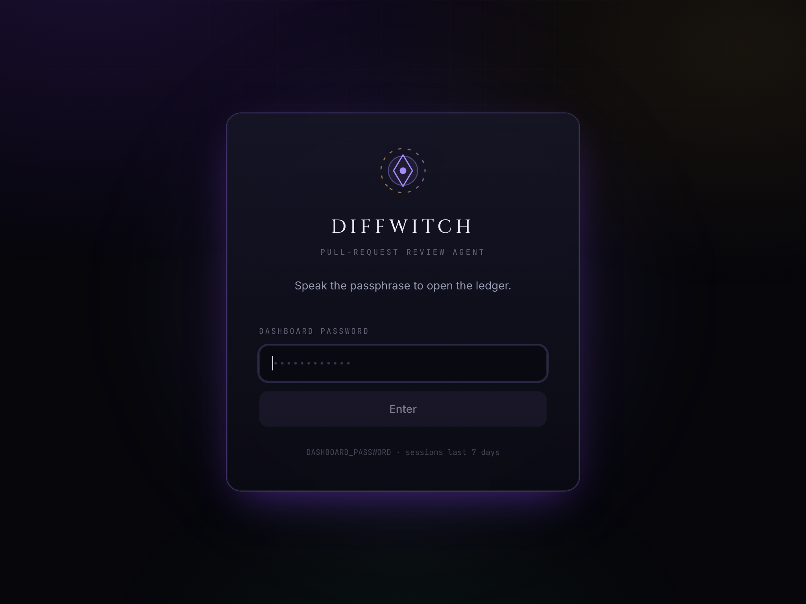

# DiffWitch

An AI pull-request reviewer that runs as a GitHub App, posts inline review
comments, and streams its reasoning to a live dashboard — built to run entirely
on free tiers.

```
PR opened ──▶ GitHub webhook ──▶ FastAPI (Render free) ──▶ jobs table (Neon)
                                        │                        │
                                        │ 200 in <100 ms         ▼
                                        │                 worker loop
                                        │                        │
                                        │        ┌───────────────┴──────────────┐
                                        │        ▼                              ▼
                                        │   MCP tools (in-process)        Gemini free tier
                                        │   get_diff / read_file / ...    (1 call in LITE mode)
                                        │        │                              │
                                        ▼        ▼                              ▼
                                  run_steps ◀────┴──── structured review JSON
                                        │
                     SSE / polling      ▼
                              Next.js dashboard (Vercel free)
```

## What it does

1. Verifies the `X-Hub-Signature-256` HMAC of every GitHub delivery, ignores
   duplicate delivery IDs, answers `200` immediately and enqueues a job.
2. A worker claims the job, authenticates as the GitHub App (JWT →
   installation token), filters and truncates the diff, and runs the review
   agent.
3. The agent returns validated JSON (`summary`, `overall_risk`, `comments[]`)
   and posts **one** GitHub review with inline comments on lines that really
   exist in the diff.
4. Every tool call, LLM call and token estimate is persisted as a `run_step`
   and streamed to the dashboard over SSE (with automatic polling fallback).

## Review modes

| Mode | LLM calls | Use |
| --- | --- | --- |
| `lite` (default) | 1 per PR | Fits the Gemini free tier. All filtered files batched into one prompt. |
| `agent` | ≤ `MAX_AGENT_STEPS` (default 3) | Bounded tool-calling loop for extra context. |

## Free-tier design

| Constraint | How DiffWitch handles it |
| --- | --- |
| Render sleeps after ~15 min | Uptime pinger hits `/health` every 10 min; dashboard shows a "waking up" state with retry. |
| Render has an ephemeral disk | Nothing is written to disk. Postgres is the only store. |
| No Redis | `jobs` table + `FOR UPDATE SKIP LOCKED` claim, worker loop in the FastAPI lifespan. |
| One free service | The MCP server runs in the same FastAPI process. |
| Instance restarts | Stuck `running` jobs are requeued on startup. |
| Gemini limits (~5 RPM / ~20 RPD) | One LLM call in LITE mode, RPM limiter, daily budget in Postgres, `skipped: quota` runs. |
| Neon pooled connections | Prepared-statement cache disabled, small pool, pre-ping. |

## Repository layout

```
backend/    FastAPI app, worker, MCP tools, Alembic migrations, tests
frontend/   Next.js App Router dashboard (dark, cinematic)
docs/       SETUP, DEPLOYMENT, GITHUB_APP, ARCHITECTURE
```

## Quick start

See [docs/SETUP.md](docs/SETUP.md). Short version (PowerShell):

```powershell
Set-Location backend
py -3.12 -m venv .venv
.\.venv\Scripts\Activate.ps1
pip install -r requirements-dev.txt
Copy-Item .env.example .env
alembic upgrade head
uvicorn app.main:app --reload --port 8000
```

## Deploy

Neon → Render → Vercel, then point the GitHub App's webhook at Render. Full
walkthrough, including every environment variable and an uptime pinger:
[docs/DEPLOYMENT.md](docs/DEPLOYMENT.md). Creating and installing the App:
[docs/GITHUB_APP.md](docs/GITHUB_APP.md). How it all fits together:
[docs/ARCHITECTURE.md](docs/ARCHITECTURE.md).

## The dashboard

A password-protected Next.js app: a runs ledger, a run page with the agent's
reasoning trace streaming in live, a quota page that shows the Gemini budget
before it runs out, and settings that override the review mode, caps and filters
per run.



Runs and run detail screenshots are added once the app is deployed against a real
repository — the UI is built and type-checked, but a trace needs real LLM calls
to photograph.

## Dashboard quick start

```powershell
Set-Location frontend
npm install
Copy-Item .env.example .env.local
# set NEXT_PUBLIC_API_URL=http://127.0.0.1:8000 in .env.local
npm run dev
```

Log in with the backend's `DASHBOARD_PASSWORD`. See [docs/SETUP.md](docs/SETUP.md#8-run-the-dashboard-frontend).

## Licence

MIT — see [LICENSE](LICENSE).
